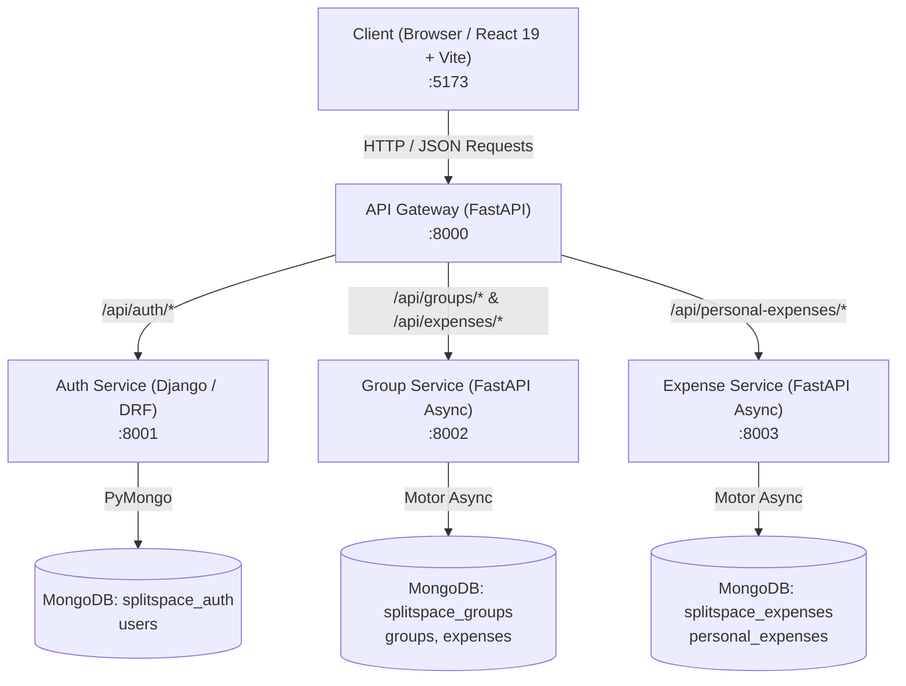
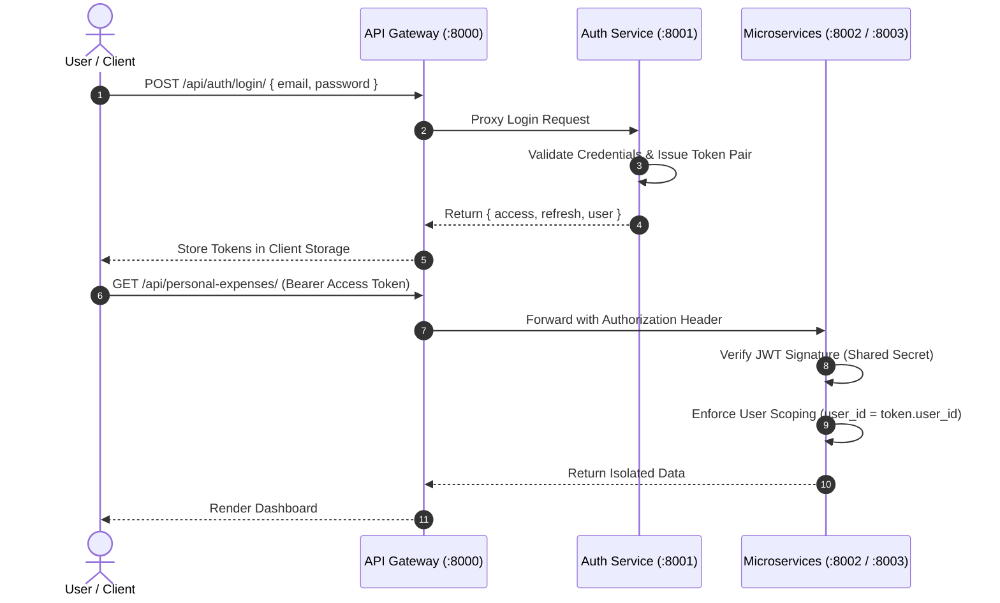
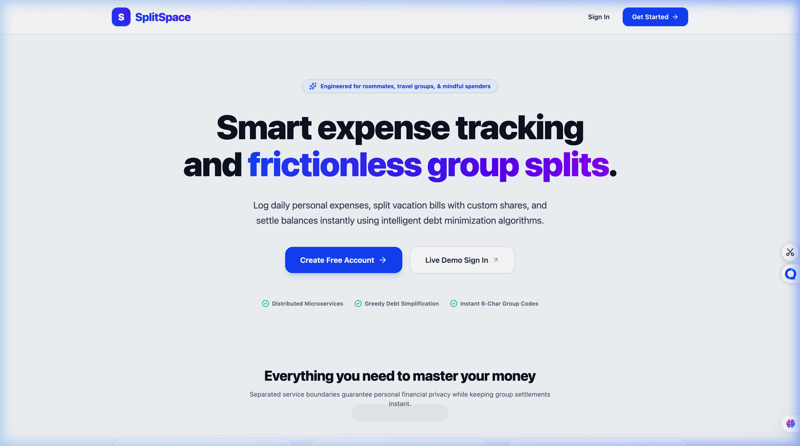
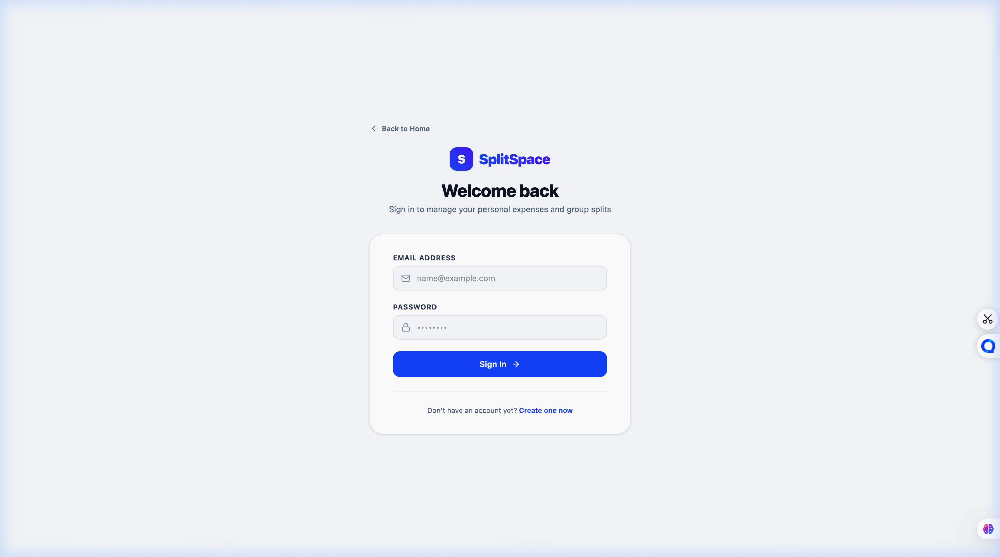
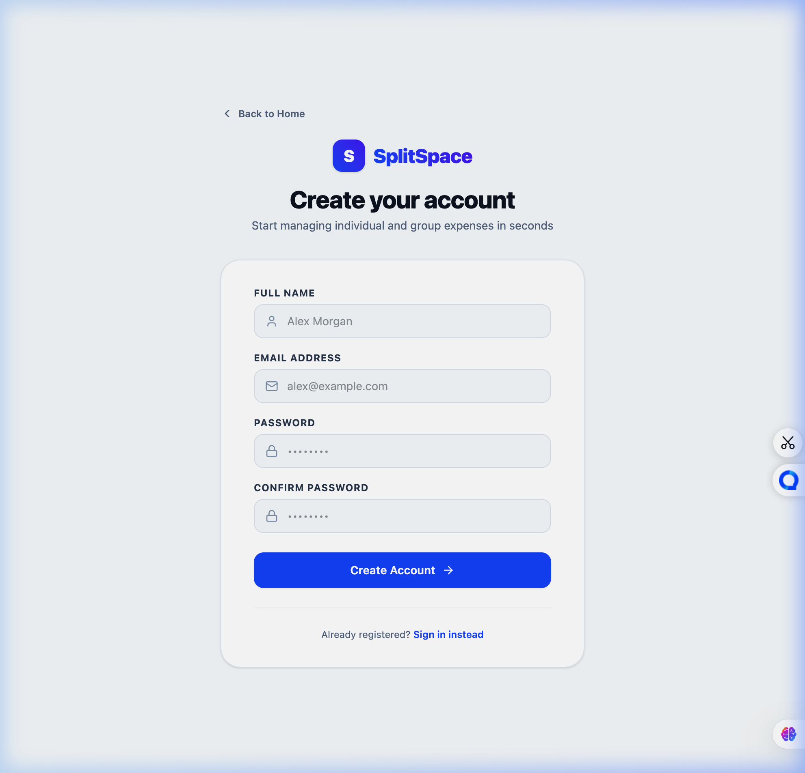
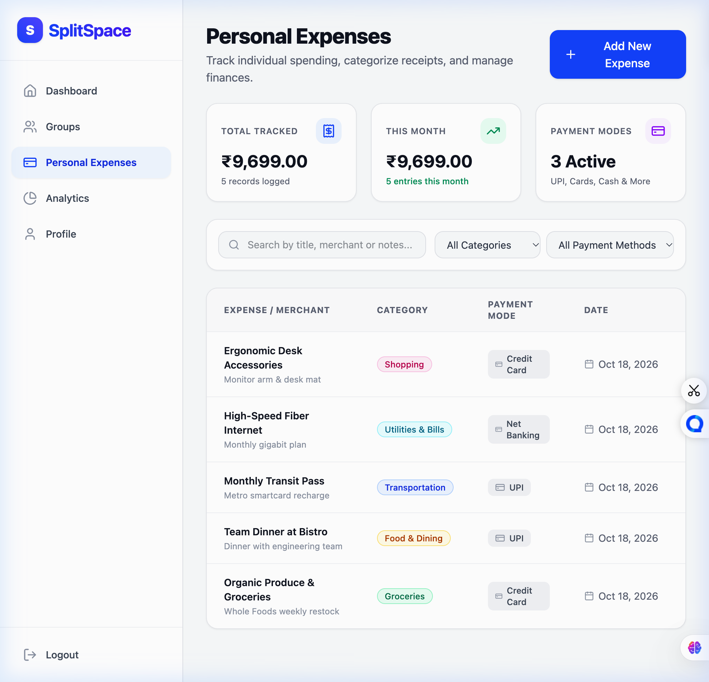
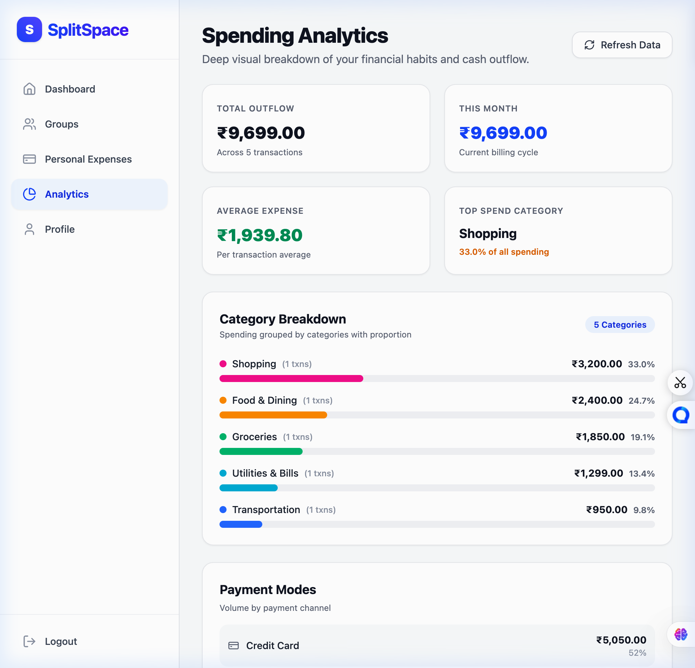
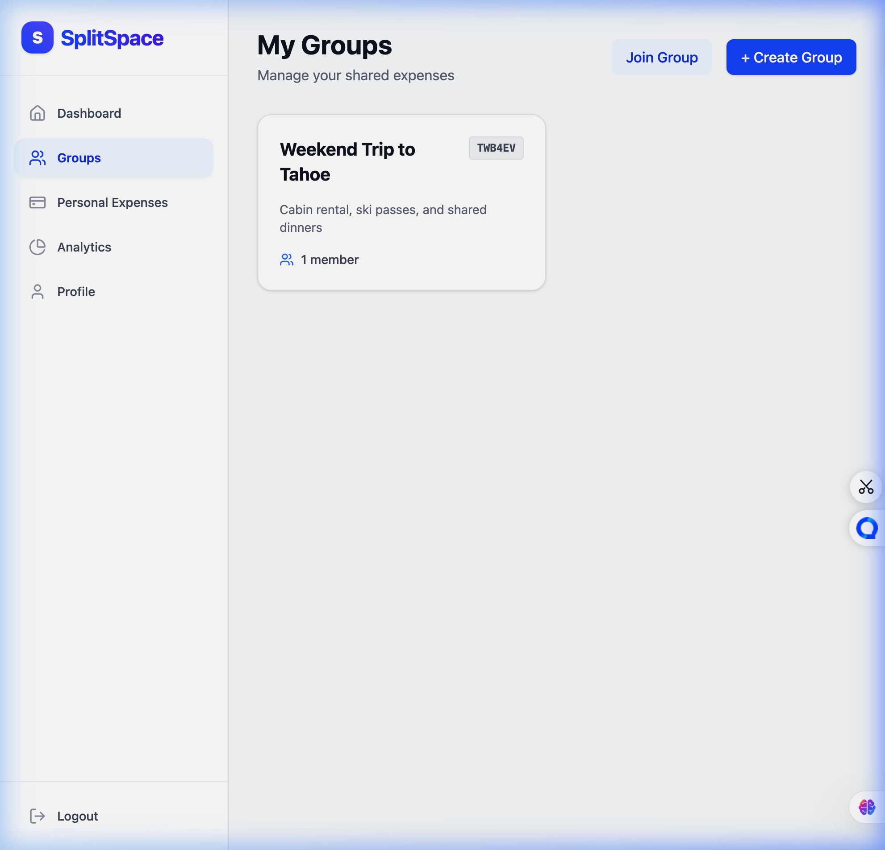
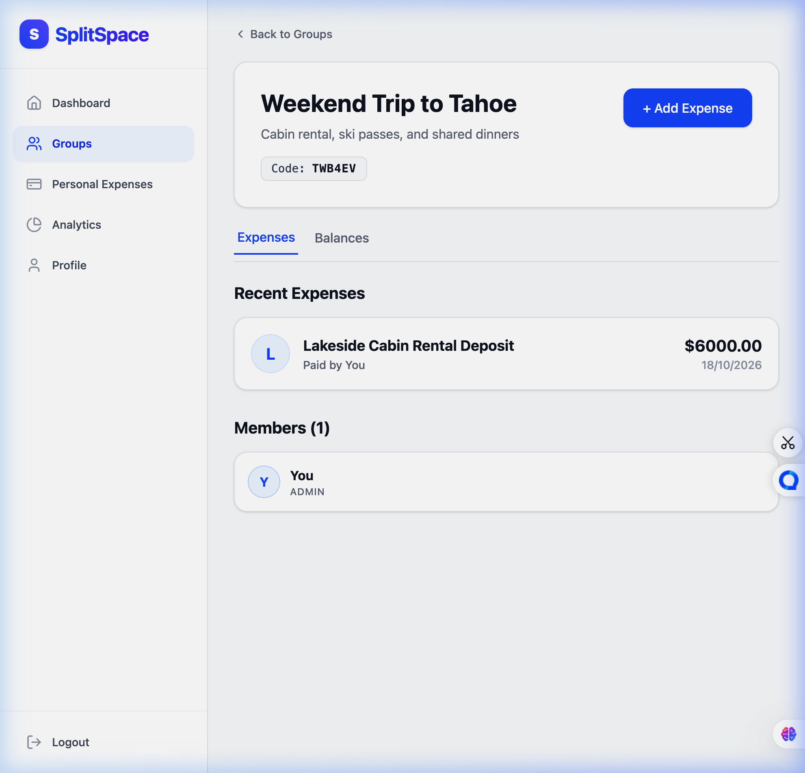
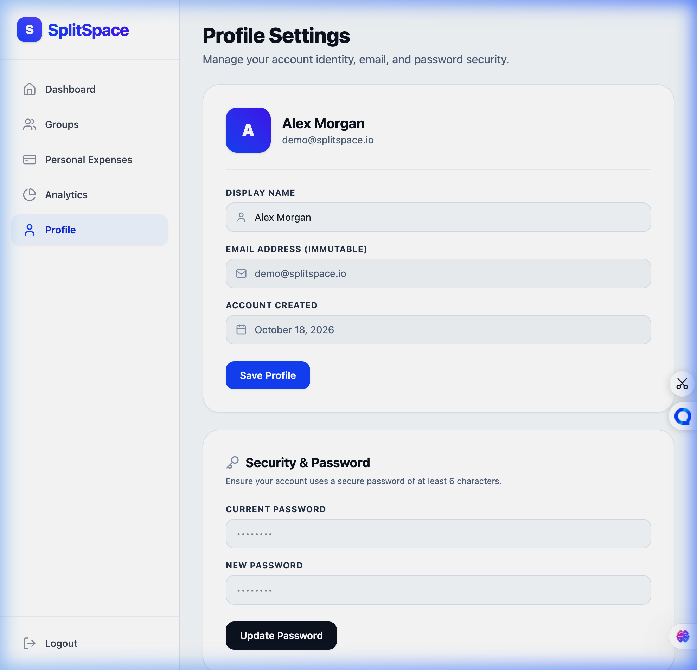

# SplitSpace

A distributed, microservices-powered financial platform for personal expense tracking, collaborative group bill splitting, and optimal debt settlement minimization.

---

<p align="center">
  
</p>

---

## ⚡ Quick Links
- **[System Architecture](docs/ARCHITECTURE.md)** — Detailed microservices design, boundaries, and data flow.
- **[API Reference](docs/API.md)** — Verified endpoint definitions with request/response schemas.
- **[Testing & QA](docs/TESTING.md)** — Integration test suites and build verification.
- **[Security Policy](docs/SECURITY.md)** — Authentication, authorization, and data isolation models.

---

## 🚀 Key Features

* **Personal Expense Tracking**: Dedicated log of daily out-of-pocket expenses with instant categorization (Food, Groceries, Shopping, Transportation, Utilities) and payment channel tagging (UPI, Credit/Debit Card, Net Banking, Cash).
* **Spending Analytics & Velocity**: Visual category distribution progress bars, month-over-month run-rate tracking, average daily burn, and smart financial budgeting tips.
* **Collaborative Group Splits**: Create groups with friction-free 6-character alphanumeric invite codes. Add expenses with equal or custom split allocations.
* **Greedy Debt Minimization**: Automatically calculates net member balances and optimizes repayment paths, pairing debtors directly with creditors to minimize settlement transactions.
* **Settlement Tracking**: Direct in-app record settlement flow resolving debts with instant balance reconciliation.
* **API Gateway Reverse Proxy**: Unified reverse proxy on port `8000` routing traffic seamlessly to Django and FastAPI microservices with centralized CORS handling.

---

## 🛠️ Technology Stack (Verified Against Source Code)

| Layer | Technologies | Purpose |
|---|---|---|
| **Frontend** | React 19, Vite, Tailwind CSS v4, Lucide React, Axios, React Router v7 | Single Page Application with reactive dashboards, modals, and real-time state |
| **API Gateway** | Python 3.10+, FastAPI, Uvicorn, HTTPX | Central reverse proxy, CORS multiplexer, routing port `8000` to downstream microservices |
| **Auth Microservice** | Python 3.10+, Django 5.x, Django REST Framework, PyMongo, PyJWT | User registration, password hashing (PBKDF2 SHA-256), access/refresh JWT tokens (port `8001`) |
| **Group Microservice** | Python 3.10+, FastAPI, Motor (Async MongoDB), Pydantic v2, PyJWT | Group lifecycle, invite codes, split expense logic, greedy debt settlement algorithm (port `8002`) |
| **Expense Microservice** | Python 3.10+, FastAPI, Motor (Async MongoDB), Pydantic v2, PyJWT | Personal expense CRUD, category breakdowns, payment mode aggregations, monthly trends (port `8003`) |
| **Database** | MongoDB 6.0+ | 3 dedicated databases: `splitspace_auth`, `splitspace_groups`, `splitspace_expenses` |
| **Security** | Stateless JWT (HS256 Bearer Tokens) | Shared secret verification with automatic refresh token rotation |

---

## 🏛️ System Architecture



---

## 📂 Repository Structure

```
splitSpace/
├── .github/                      # GitHub Actions CI workflow definitions
│   └── workflows/
│       └── ci.yml                # Automated build and test pipeline
├── docs/                         # Extended documentation & genuine UI screenshots
│   ├── ARCHITECTURE.md           # In-depth architectural guide
│   ├── API.md                    # Verified API endpoint reference
│   ├── TESTING.md                # Testing instructions & verification logs
│   ├── SECURITY.md               # Security guidelines & data isolation
│   └── screenshots/              # Authentic application screenshots
├── frontend/                     # React 19 + Vite Single Page Application
│   ├── src/
│   │   ├── api/                  # Axios HTTP clients (client, auth, groups, personalExpenses)
│   │   ├── components/           # Reusable UI widgets (Sidebar, ProtectedRoute)
│   │   ├── context/              # AuthContext & token management
│   │   ├── pages/                # Landing, Login, Register, Dashboard, Groups, GroupDetails, Expenses, Analytics, Profile
│   │   ├── App.jsx               # Route definitions
│   │   └── main.jsx
│   ├── package.json
│   └── vite.config.js
├── backend/                      # Backend microservices cluster
│   ├── api-gateway/              # FastAPI central reverse proxy (Port 8000)
│   ├── auth-service/             # Django authentication microservice (Port 8001)
│   ├── group-service/            # FastAPI group & split expense microservice (Port 8002)
│   ├── expense-service/          # FastAPI personal expense & analytics microservice (Port 8003)
│   ├── init_db.py                # Database & collection initialization script
│   ├── test_groups.py            # Automated group settlement test suite
│   ├── test_personal_expenses.py # Automated personal expense integration test suite
│   └── seed_demo.py              # Realistic demo seed data generator
├── .gitignore
└── README.md
```

---

## 🔄 How the Application Works

1. **Authentication**: Users register and log in via the Auth service. Upon successful verification, the client receives an HMAC-SHA256 access token and refresh token.
2. **Reverse Proxy Routing**: All client calls hit `http://localhost:8000/api`. The Gateway dispatches requests by path prefix (`/auth`, `/groups`, `/expenses`, `/personal-expenses`) directly to downstream services.
3. **Personal Budgeting**: Users record daily transactions in `expense-service`. Aggregations calculate category distributions, monthly velocity, and run-rates.
4. **Group Expense Sharing**: Users form a group and share a 6-character code. Expenses are recorded with equal or custom allocations.
5. **Debt Settlement**: Group net balances are computed on-demand. When a member submits a payment, an `is_settlement: true` record reconciles the debt.

---

## 🔐 Authentication & Authorization Flow



* **Data Isolation**: Every database query in `expense-service` requires `user_id == caller_id`. Users cannot view or edit external records.
* **Group Scoping**: Every group operation verifies that `members.user_id` contains the caller's ID; non-members receive HTTP `403 Forbidden`.

---

## 📡 API Endpoint Reference (Verified Against Routes)

All client communication is routed through the API Gateway at `http://localhost:8000/api`.

### 🔐 Authentication Service (`/api/auth/*`)
| Method | Endpoint | Description | Auth Required |
|---|---|---|---|
| `POST` | `/api/auth/register/` | Register a new user | No |
| `POST` | `/api/auth/login/` | User login (returns access & refresh tokens) | No |
| `POST` | `/api/auth/token/refresh/` | Refresh expired access token | No |
| `GET` | `/api/auth/me/` | Fetch current user profile | Bearer Token |
| `PUT` | `/api/auth/profile/` | Update profile information | Bearer Token |
| `POST` | `/api/auth/change-password/` | Update account password | Bearer Token |
| `POST` | `/api/auth/logout/` | Revoke tokens & logout | Bearer Token |

### 👥 Group Service (`/api/groups/*`)
| Method | Endpoint | Description | Auth Required |
|---|---|---|---|
| `POST` | `/api/groups/` | Create a new group (auto-generates 6-character code) | Bearer Token |
| `GET` | `/api/groups/` | List all groups the current user is a member of | Bearer Token |
| `GET` | `/api/groups/{id}` | Get details and member roster of a group | Bearer Token |
| `POST` | `/api/groups/join` | Join group via 6-character invite code | Bearer Token |
| `GET` | `/api/groups/{id}/balances` | Calculate net balances and optimal settlement transactions | Bearer Token |

### 💸 Group Split Expenses (`/api/expenses/*`)
| Method | Endpoint | Description | Auth Required |
|---|---|---|---|
| `POST` | `/api/expenses/` | Add group expense or record debt settlement repayment | Bearer Token |
| `GET` | `/api/expenses/group/{group_id}` | Retrieve all expense history for a group | Bearer Token |

### 💳 Personal Expenses & Analytics (`/api/personal-expenses/*`)
| Method | Endpoint | Description | Auth Required |
|---|---|---|---|
| `POST` | `/api/personal-expenses/` | Log a new personal expense with category & payment method | Bearer Token |
| `GET` | `/api/personal-expenses/` | List personal expenses with search & filter params | Bearer Token |
| `GET` | `/api/personal-expenses/{id}` | Get individual personal expense details | Bearer Token |
| `PUT` | `/api/personal-expenses/{id}` | Update an existing personal expense | Bearer Token |
| `DELETE` | `/api/personal-expenses/{id}` | Remove a personal expense | Bearer Token |
| `GET` | `/api/personal-expenses/analytics/summary` | Generate spending metrics, monthly velocity & category breakdown | Bearer Token |

---

## 🗄️ Database Design & Indexes

Initialized via `python backend/init_db.py`:

```
splitspace_auth
└── users: unique index (email), unique index (id)

splitspace_groups
├── groups: unique index (code), unique index (id), index (members.user_id)
└── expenses: unique index (id), index (group_id)

splitspace_expenses
└── personal_expenses: unique index (id), index (user_id), index (date), index (category), compound index (user_id ASC, date DESC)
```

---

## 🧮 Debt Settlement Minimization Algorithm

### How it Works
When a group shares expenses, direct pairing between members results in $O(N^2)$ transactions. SplitSpace uses a **Greedy Net-Balance Minimizer**:

1. **Calculate Net Balances**:
   * Alice paid \$90 for dinner split equally between Alice, Bob, and Charlie (\$30 each).
   * Net Balances: Alice: `+$60`, Bob: `-$30`, Charlie: `-$30`.
2. **Sort Debtors and Creditors**:
   * Creditors: `[Alice: $60]`
   * Debtors: `[Bob: $30, Charlie: $30]`
3. **Greedy Matching**:
   * Bob pays Alice \$30 (Bob's balance becomes \$0, Alice's balance becomes \$30).
   * Charlie pays Alice \$30 (Charlie's balance becomes \$0, Alice's balance becomes \$0).
4. **Result**: 2 simple transactions instead of circular confusion.

---

## 🚀 Installation & Local Setup

### 1. Prerequisites
- **Python 3.10+**
- **Node.js 18+** & npm
- **MongoDB** running locally on port `27017` (`mongodb://localhost:27017`)

---

### 2. Environment Configuration

Copy the template configuration files for each service:

```bash
cp backend/auth-service/.env.example backend/auth-service/.env
cp backend/group-service/.env.example backend/group-service/.env
cp backend/expense-service/.env.example backend/expense-service/.env
cp backend/api-gateway/.env.example backend/api-gateway/.env
cp frontend/.env.example frontend/.env
```

All `.env.example` templates contain safe development defaults:
```env
MONGO_URI=mongodb://localhost:27017
JWT_SECRET=supersecretjwtkey_replace_me_in_production
VITE_API_BASE_URL=http://localhost:8000/api
```

---

### 3. Initialize MongoDB Collections & Indexes

```bash
python backend/init_db.py
```

---

### 4. Run the Application

Open separate terminal windows/tabs for each service:

#### **Tab 1: Auth Service (Port 8001)**
```bash
cd backend/auth-service
python3 -m venv venv
source venv/bin/activate
pip install -r requirements.txt
python manage.py runserver 8001
```

#### **Tab 2: Group Service (Port 8002)**
```bash
cd backend/group-service
python3 -m venv venv
source venv/bin/activate
pip install -r requirements.txt
uvicorn main:app --host 0.0.0.0 --port 8002 --reload
```

#### **Tab 3: Expense Service (Port 8003)**
```bash
cd backend/expense-service
python3 -m venv venv
source venv/bin/activate
pip install -r requirements.txt
uvicorn main:app --host 0.0.0.0 --port 8003 --reload
```

#### **Tab 4: API Gateway (Port 8000)**
```bash
cd backend/api-gateway
python3 -m venv venv
source venv/bin/activate
pip install -r requirements.txt
uvicorn main:app --host 0.0.0.0 --port 8000 --reload
```

#### **Tab 5: React Frontend (Port 5173)**
```bash
cd frontend
npm install
npm run dev
```

Visit the app at **http://localhost:5173**.

---

## 🧪 Testing Instructions & Verification

Verify the entire system with the automated test suites:

```bash
# 1. Group Service & Debt Settlement Integration Tests
python backend/test_groups.py

# 2. Personal Expenses & Financial Analytics Integration Tests
python backend/test_personal_expenses.py

# 3. Frontend Production Build Check
cd frontend && npm run build
```

**Verification Status**:
- `test_groups.py`: ✔ **100% Passed** (User registration, group creation, equal splits, balances, settlement).
- `test_personal_expenses.py`: ✔ **100% Passed** (CRUD, category filtering, analytics aggregations, deletion).
- `npm run build`: ✔ **100% Passed** (Zero warnings, production bundle built cleanly in ~685ms).

---

## 📸 Screenshots Gallery

| Screen | Preview |
|---|---|
| **Landing Page** |  |
| **User Sign In** |  |
| **Account Registration** |  |
| **Command Dashboard** |  |
| **Personal Expenses** |  |
| **Spending Analytics** |  |
| **Group Management** |  |
| **Group Details & Splits** |  |
| **Profile Settings** |  |

---

## ⚠️ Known Limitations & Future Roadmap

* **Asymmetric Key Pairs**: Current microservices use a symmetric `HS256` secret. Transitioning to `RS256` public/private key pairs will further restrict token signing exclusively to the Auth Service.
* **Rate Limiting**: Implementing IP-level token bucket rate limiting on the API Gateway to prevent brute-force login attempts.
* **Receipt Image Upload**: Integrating AWS S3 / Cloudflare R2 for receipt attachments.

---

## 📜 License

This project is licensed under the [MIT License](LICENSE).
