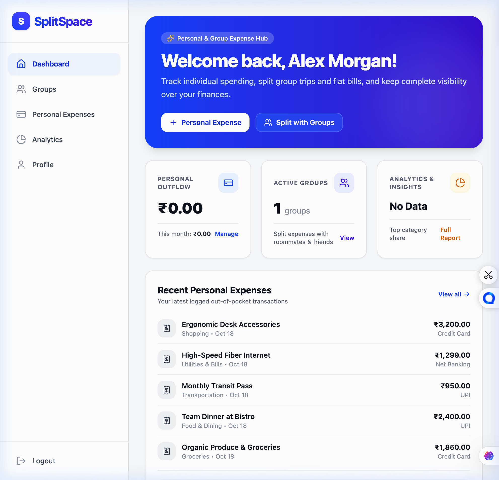
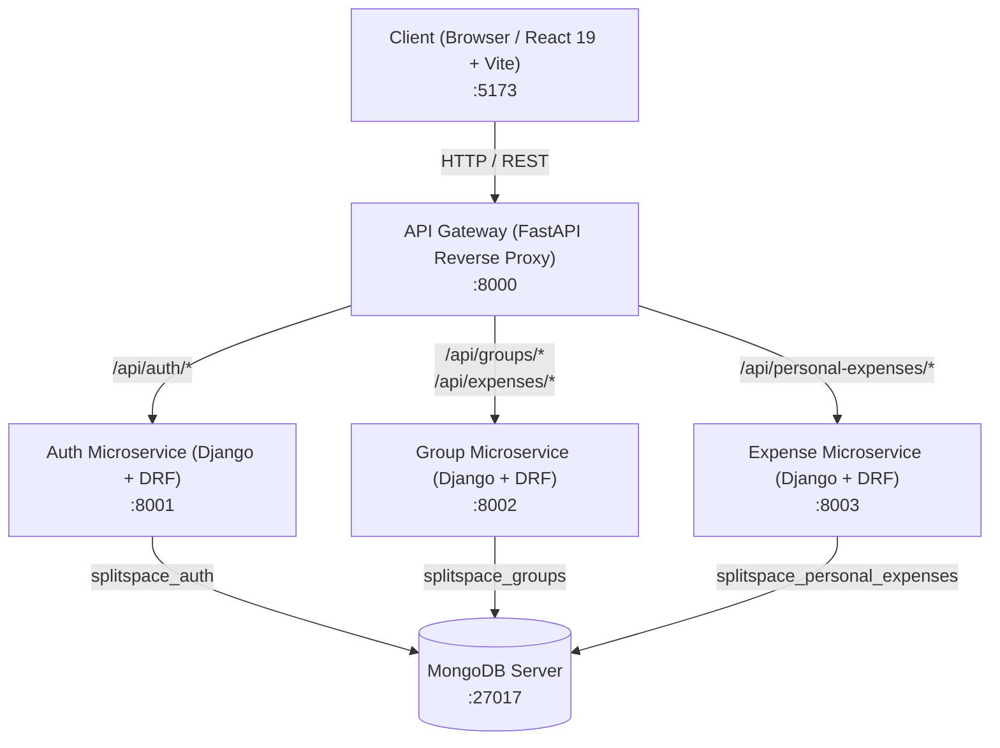

# SplitSpace

A distributed, pure Django & FastAPI microservices-powered financial platform for personal expense tracking, collaborative group bill splitting, and optimal debt settlement minimization.

---

<p align="center">
  
</p>

---

## ⚡ Quick Links
- **[Backend Architecture Specification](docs/BACKEND_ARCHITECTURE.md)** — Exhaustive guide covering all Django microservices, data access methods, and greedy minimization workflows.
- **[System Architecture](docs/ARCHITECTURE.md)** — Microservices topology, boundaries, and asynchronous data flows.
- **[API Reference](docs/API.md)** — Verified endpoint definitions with request/response schemas.
- **[Testing & QA](docs/TESTING.md)** — Integration test suites and build verification.
- **[Security Policy](docs/SECURITY.md)** — Authentication, authorization, and data isolation models.

---

## 🚀 Key Features

* **Personal Expense Tracking (INR ₹)**: Dedicated ledger for daily out-of-pocket expenses with instant categorization (Food, Groceries, Shopping, Transportation, Utilities) and payment channel tagging (UPI, Credit/Debit Card, Net Banking, Cash).
* **Spending Analytics & Velocity**: Visual category distribution progress bars, month-over-month run-rate tracking, average daily burn, and smart financial budgeting tips.
* **Collaborative Group Splits**: Create group spaces with friction-free 6-character alphanumeric invite codes. Add expenses with equal or custom split allocations.
* **Greedy Debt Minimization**: Automatically calculates net member balances and optimizes repayment paths, pairing debtors directly with creditors to minimize settlement transactions.
* **Settlement Tracking**: Direct in-app record settlement flow resolving debts with instant balance reconciliation.
* **API Gateway Reverse Proxy**: Unified reverse proxy on port `8000` routing traffic seamlessly to downstream Django microservices with centralized CORS handling.

---

## 🛠️ Technology Stack

| Layer | Technologies | Port | Purpose |
|---|---|---|---|
| **Frontend** | React 19, Vite, Tailwind CSS v4, Lucide React, Axios, React Router v7 | `5173` | Modern corporate-institutional single page application with reactive state |
| **API Gateway** | Python 3.10+, FastAPI, Uvicorn, HTTPX | `8000` | Central reverse proxy, CORS multiplexer, routing port `8000` to downstream microservices |
| **Auth Microservice** | Python 3.10+, Django 5.x, DRF, PyMongo, PyJWT | `8001` | User registration, password hashing (PBKDF2 SHA-256), access/refresh JWT tokens |
| **Group Microservice** | Python 3.10+, Django 5.x, DRF, PyMongo, PyJWT | `8002` | Group spaces, 6-character invite codes, split expense logic, greedy debt settlement algorithm |
| **Expense Microservice** | Python 3.10+, Django 5.x, DRF, PyMongo, PyJWT | `8003` | Personal expense CRUD, category breakdowns, payment mode aggregations, monthly trends |
| **Database** | MongoDB 6.0+ | `27017` | Dedicated databases: `splitspace_auth`, `splitspace_groups`, `splitspace_personal_expenses` |
| **Security** | Stateless JWT (HS256 Bearer Tokens) | — | Shared secret verification with automatic refresh token rotation |

---

## 🏛️ System Architecture



---

## ⚙️ Running the Full Project Locally

### Prerequisites
- Python 3.10+
- Node.js 18+ and npm
- MongoDB running on `localhost:27017`

### 1. Start MongoDB
```bash
brew services start mongodb-community
```

### 2. Launch All Microservices

Open 5 terminal windows or tabs from the project root:

```bash
# Terminal 1: API Gateway (Port 8000)
cd backend/api-gateway
source ../expense-service/venv/bin/activate
uvicorn main:app --host 0.0.0.0 --port 8000 --reload

# Terminal 2: Auth Service (Django - Port 8001)
cd backend/auth-service
source venv/bin/activate
python manage.py runserver 0.0.0.0:8001

# Terminal 3: Group Service (Django - Port 8002)
cd backend/group-service
source ../auth-service/venv/bin/activate
python manage.py runserver 0.0.0.0:8002

# Terminal 4: Expense Service (Django - Port 8003)
cd backend/expense-service
source ../auth-service/venv/bin/activate
python manage.py runserver 0.0.0.0:8003

# Terminal 5: React Frontend (Port 5173)
cd frontend
npm run dev
```

Visit the app at **[http://localhost:5173](http://localhost:5173)**.

---

## 🧪 Testing & Verification

```bash
# Run Django system checks
cd backend/auth-service && python manage.py check
cd backend/group-service && python manage.py check
cd backend/expense-service && python manage.py check

# Run Frontend Build
cd frontend && npm run build
```

---

## 📄 License
This project is licensed under the MIT License — see the [LICENSE](LICENSE) file for details.
