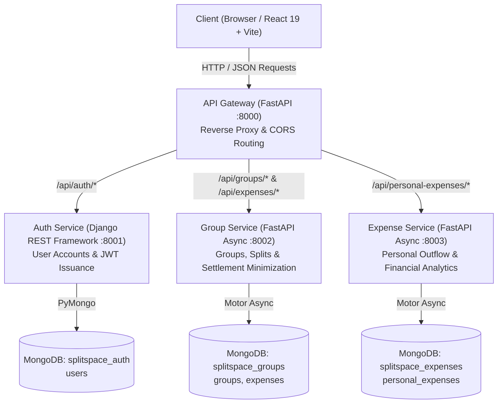
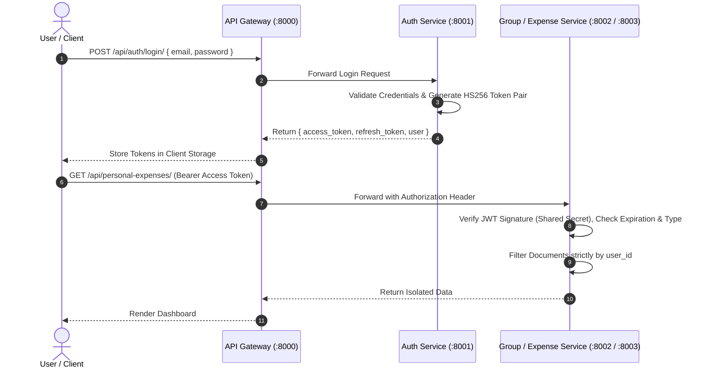

# SplitSpace — Architecture & System Design

SplitSpace is architected as a **distributed microservices system** designed to separate transactional authentication, collaborative group finances, and personal budgeting into independent services.

---

## 🏛️ High-Level System Architecture

---

## 🧩 Service Boundaries & Responsibilities

| Service | Port | Framework | Database | Primary Responsibility |
|---|---|---|---|---|
| **API Gateway** | `8000` | FastAPI / HTTPX | None | Central reverse proxy, CORS multiplexer, client entrypoint |
| **Auth Service** | `8001` | Django 5 / DRF | `splitspace_auth` | User registration, password hashing (PBKDF2), JWT token pairing & verification |
| **Group Service** | `8002` | FastAPI / Motor | `splitspace_groups` | Group lifecycle, 6-char invite codes, equal/custom splits, greedy debt settlement |
| **Expense Service** | `8003` | FastAPI / Motor | `splitspace_expenses` | Personal expense CRUD, categorization, payment method tracking, monthly spending velocity |
| **Frontend** | `5173` | React 19 / Vite | LocalStorage (Tokens) | Reactive dashboard, live charts, settlement flows, responsive UI |

---

## 🔄 Authentication & Authorization Flow

1. **Stateless JWT**: All microservices verify JWT bearer tokens using a shared secret (`JWT_SECRET`).
2. **Access + Refresh Pairing**: Short-lived access tokens prevent unauthorized exposure. The Axios client automatically catches `401 Unauthorized` responses and exchanges the refresh token at `/api/auth/token/refresh/`.
3. **Data Isolation**:
   - `personal_expenses` queries are permanently scoped to `{"user_id": user_id}`.
   - `group` and `group_expenses` operations verify that `members.user_id` contains the caller's ID before allowing read/write operations.

---

## 🧮 Debt Settlement Minimization Algorithm

In group expense management, naive repayments require $O(N^2)$ transactions. SplitSpace simplifies debts using a **Greedy Net-Balance Settlement Algorithm**:

1. **Calculate Net Balances**:
   $$\text{Net Balance}(u) = \sum \text{Paid by } u - \sum \text{Owed by } u$$
2. **Partition Members**:
   - **Debtors**: Net balance $< 0$ (sorted descending by amount owed).
   - **Creditors**: Net balance $> 0$ (sorted descending by amount owed to them).
3. **Greedy Matching**:
   - Pair the largest debtor with the largest creditor.
   - Settle the minimum of what is owed vs what is credit-eligible.
   - Update balances and repeat until all balances reach zero.
4. **Complexity**: Reduces transaction count to at most $N - 1$ payments.

---

## 🗄️ Database Schemas & Indexing Strategy

### 1. `splitspace_auth.users`
* `id` (UUID string, unique index)
* `email` (string, unique index)
* `name` (string)
* `password` (PBKDF2 SHA-256 hashed string)
* `created_at` (UTC timestamp)

### 2. `splitspace_groups.groups`
* `id` (UUID string, unique index)
* `code` (6-character uppercase alphanumeric string, unique index)
* `name` (string)
* `description` (optional string)
* `created_by` (user ID string)
* `members` (array of `{ user_id, role, joined_at }`, indexed on `members.user_id`)

### 3. `splitspace_groups.expenses`
* `id` (UUID string, unique index)
* `group_id` (UUID string, indexed)
* `description` (string)
* `total_amount` (float)
* `paid_by` (user ID string)
* `splits` (array of `{ user_id, amount, paid }`)
* `is_settlement` (boolean)

### 4. `splitspace_expenses.personal_expenses`
* `id` (UUID string, unique index)
* `user_id` (string, indexed)
* `title` (string)
* `amount` (float)
* `category` (string, indexed)
* `payment_method` (string)
* `date` (UTC timestamp, indexed)
* Compound index: `[("user_id", 1), ("date", -1)]` for ultra-fast reverse-chronological queries.
